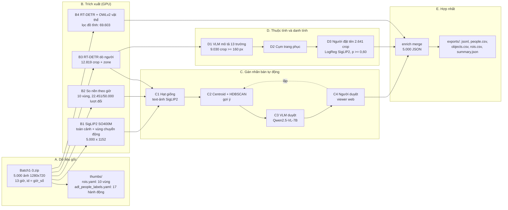

# Quy trình xử lý dữ liệu Castle5000: từ ảnh gốc đến bộ dữ liệu hiện tại

Tài liệu gom lại những gì đã làm trong `labeling/`, để viết mục phương pháp của bài báo.
Sơ đồ vector: [`pipeline_modules.svg`](pipeline_modules.svg) (module, vào/ra từng module) và
[`pipeline_architecture.svg`](pipeline_architecture.svg) (tổng quan theo giai đoạn). Mọi con số lấy từ
`exports/summary.json`, `labeling/work/logs/` và `labeling/annotations/`, đối chiếu ngày 2026-11-14.

## 1. Tóm tắt một đoạn

5.000 ảnh từ một camera trần cố định trong bếp chung (13 giờ liên tục, 1280×720) được xử lý thành
bộ dữ liệu có cấu trúc cho truy hồi ảnh theo văn bản. Đơn vị gán nhãn không phải cả ảnh mà là
**crop**: 12.819 crop người (hành động, thuộc tính, danh tính), 10 vùng cố định × 5.000 ảnh = 50.000
lượt vùng (trạng thái), và 69.603 vật thể. Nhãn đi theo vòng lặp bán tự động của LSC-ADL
(arXiv:2504.02060): câu mô tả → ảnh hạt giống → centroid → gom cụm → gợi ý → duyệt; ở đây vai trò
"người duyệt vòng đầu" do Qwen2.5-VL-7B đảm nhiệm, người chỉ soát và sửa trên giao diện web.

## 2. Sơ đồ kiến trúc

## 3. Từng bước đã làm

### A. Chuẩn bị nguồn

| Việc | Chi tiết |
|---|---|
| Nguồn | `Batch1.zip` (1.853 ảnh), `Batch2.zip` (1.767), `Batch3.zip` (1.380); `data-*.zip` chỉ bọc lại ba file này |
| Chuẩn hoá | 5.000 JPEG 1280×720 vào `dataset/images/`; id `<giờ>_<số thứ tự>` (ví dụ `08_1002`); 13 nhóm giờ 08–20, mỗi giờ 358–412 ảnh; thumbnail cho trang duyệt |
| Bộ nhãn | Soạn tay: 17 hành động của người (`adl_people_labels.yaml`), mỗi lớp 7 câu mô tả tiếng Anh; 10 vùng cố định khai báo trong `rois.yaml` (khung, zone, 3–4 trạng thái, câu mô tả) |

Hai điều kiện của dữ liệu quyết định thiết kế: camera cố định (nên có thể trừ nền và khai báo vùng
bằng toạ độ), và nhìn chếch từ trên xuống (nên ít thấy mặt, nhận diện người bằng khuôn mặt không dùng được).

### B. Trích xuất (cần GPU, chạy ở máy local, ngày 2026-11-11)

| Bước | Model / phương pháp | Kết quả |
|---|---|---|
| B1. Embedding ảnh (`adl embed`) | SigLIP2 SO400M/384 (open_clip, webli), 1152 chiều. Vector cuối = vector toàn cảnh + vector vùng có người; vùng có người tìm bằng trừ nền trung vị theo giờ (ảnh xám 160×90, ngưỡng 25) | 5.000 ảnh, 20,4 phút; 4.231 ảnh có vùng focus |
| B2. So nền 10 vùng (`enrich build`) | Mỗi giờ lấy một ảnh nền (ít chuyển động nhất). Vùng đổi ≥ 10% pixel (ảnh xám 320×180, ngưỡng 25) thì cắt crop ở độ phân giải gốc rồi mã hoá | 22.451 / 50.000 lượt đổi. Lượt không đổi thừa hưởng nhãn của ảnh nền giờ đó |
| B3. Dò người | RT-DETR r50vd (COCO), điểm ≥ 0,45, NMS 0,70, tối đa 10 người/ảnh, bỏ box < 0,4% khung. Gán `zone` bằng hình học (box phủ ≥ 35% zone) | 12.819 crop (3,4 người/ảnh), mỗi crop một vector SigLIP2 |
| B4. Vật thể (`enrich objects`) | RT-DETR giữ các lớp COCO trừ đồ cố định (bàn, ghế, tủ lạnh, ...) + OWLv2 với 10 truy vấn tên vật (nồi, chảo, khăn, thớt, ...). Lúc merge bỏ box nằm cùng chỗ (IoU ≥ 0,5) trong ≥ 15% số ảnh | 43.656 + 52.283 box thô, 19 vị trí tĩnh bị loại, còn 69.603 vật thể |

### C. Gán nhãn bán tự động (vòng lặp LSC-ADL, dùng chung cho mọi tầng qua `--profile`)

Cùng một vòng lặp chạy trên ba loại đơn vị: ảnh nguyên khung, crop người (`people`), crop từng vùng (`roi-<tên>`).

1. **Hạt giống** (`adl init`): encode câu mô tả bằng SigLIP2 text, lấy 8–10 crop gần nhất mỗi câu (cosine ≥ 0,05; trần 40–60 crop/lớp).
2. **Centroid + gợi ý** (`adl round`): HDBSCAN gom cụm lại trong từng lớp (min_cluster 4–5); crop có cosine tới centroid ≥ 0,60 (người) hoặc ≥ 0,55 (vùng) được gợi ý, tối đa 400–600 gợi ý mỗi vòng.
3. **VLM duyệt vòng đầu** (`adl vlm-review`, Kaggle T4): Qwen2.5-VL-7B nhìn crop và chọn một lớp trong bộ nhãn, không được biết nhãn máy gợi ý. Cùng lớp → `agree`; lớp khác → `changed`; "không lớp nào" → loại và không gợi ý lại; trả lời không đọc được → giữ nguyên. 3 vòng, sau đó bước `fill` cho VLM gán trực tiếp mọi crop còn trống (`direct`). 12.819 câu trả lời ghi trong `vlm_reviews.jsonl`.
4. **Người duyệt** (`viewer/`): xác nhận, từ chối, đổi lớp, vẽ box. Nhãn người (`source: human`) luôn thắng nhãn VLM, VLM không bao giờ ghi đè.

Có sửa vòng lặp theo dữ liệu: bỏ lớp "oven door open" (soát 44 nhãn VLM đều sai), đổi trạng thái thùng rác từ đóng/mở sang có rác/không rác (thùng không nắp), chỉnh lại khung `living_area` và `fridge`, và thêm `vlm_hint` cho vùng tủ lạnh (không có câu gợi ý thì VLM chọn "cannot tell" cho mọi ảnh tủ đóng).

### D. Thuộc tính và danh tính của từng người

1. **Thuộc tính** (`pipeline --steps attrs`, Kaggle): Qwen2.5-VL-7B trả một dòng 13 trường (giới, tuổi, tóc, áo, màu, hoa văn, quần, mũ, kính, tạp dề, đồ cầm, hướng nhìn). Chỉ chạy trên crop cao ≥ 160 px (9.030 crop), vì crop nhỏ VLM đoán bừa.
2. **Cụm trang phục** (`enrich identities`, `method: outfit`): khoá = (giới, loại áo, màu áo, hoa văn) sau chuẩn hoá. Khoá có ≥ 15 crop thành một cụm; crop còn lại xếp vào cụm có tâm SigLIP gần nhất. Quần không vào khoá vì VLM không thấy quần ở khoảng 40% crop.
3. **Đặt tên**: người duyệt đặt tên trực tiếp cho 2.641 crop (27 crop đánh dấu "không rõ"). Logistic regression (`class_weight=balanced`) trên SigLIP2 học các tên này và dự đoán mọi crop; dự đoán chỉ nhận khi xác suất ≥ 0,60. Thứ tự ưu tiên: tên đặt riêng > mô hình > tên cụm.
4. **Trang phục chuẩn** (`outfits.yaml`): mô tả đầy đủ theo từng tên và theo giờ (người thay đồ giữa buổi), điền sẵn từ câu trả lời VLM gặp nhiều nhất.

Danh tính ở đây là **danh tính theo trang phục** ("Sơ mi xanh", "Linh", ...), không phải nhận diện khuôn mặt.

### E. Hợp nhất và xuất (`enrich merge`)

Mỗi ảnh một bản ghi `annotations/enriched/<image_id>.json`: danh sách người (box, zone, hành động, thuộc tính, danh tính, trang phục), 10 vùng (đổi hay không, trạng thái), vật thể, box vẽ tay. Mỗi nhãn mang `source` (`human`, `vlm`, `seed`, `suggested`) để bước truy hồi tự chọn mức tin cậy. Xuất sang `exports/`:

| File | Số dòng |
|---|---|
| `castle_dataset.jsonl` | 5.000 (mỗi ảnh một dòng) |
| `people.csv` | 12.819 |
| `objects.csv` | 69.603 |
| `rois.csv` | 50.000 |
| `summary.json` | thống kê |

## 4. Số liệu của bộ dữ liệu cuối

| Mục | Giá trị |
|---|---|
| Ảnh | 5.000 (1.244 ảnh, 24,9%, không có người) |
| Người | 12.819; có nhãn hành động 11.737 (91,6%); có thuộc tính 8.889; có tên 4.804 |
| Nguồn nhãn hành động | vlm 11.449 · người 78 · gợi ý chưa duyệt 210 · không nhãn 1.082 |
| Hành động phổ biến | đứng không làm gì 2.163 · nấu ăn trên bếp 1.942 · sơ chế 1.807 · rửa chén 1.422 · mở tủ lạnh 1.005 |
| Vùng | 50.000 lượt; có nhãn 46.693 (vlm 45.242 · người 8 · gợi ý 1.443 · không nhãn 3.307) |
| Vật thể | 69.603 (chai 14.258 · tô 10.298 · cốc 7.769 · nồi 7.717 · khăn 6.405) |
| Hoạt động người duyệt | 78 nhãn người, 577 nhãn người bị từ chối, 3 box vẽ tay, 2.641 tên đặt riêng |

## 5. Những điều cần nói thật trong bài báo

- **Nhãn chủ yếu do VLM, người duyệt rất ít**: 11.449/11.737 nhãn hành động và 45.242/46.693 nhãn vùng là `source: vlm`. Không có độ chính xác đo được trên một tập kiểm chứng do người gán. Nếu cần báo cáo chất lượng, phải gán tay một mẫu độc lập rồi tính agreement.
- **Qwen 7B có lỗi hệ thống đã quan sát**: thử trên ảnh `09_1574`, gán "sọc ngang" sai cho 4/7 người; vùng tủ lạnh cần `vlm_hint`; nhãn "oven door open" sai toàn bộ 44 mẫu đã soát.
- **Danh tính là theo trang phục**: người đổi đồ sẽ thành hai danh tính; dự đoán bằng logistic regression có thể lẫn các áo giống nhau (tên "Sơ mi xanh" có 1.127 crop).
- **Pipeline đầu tiên đã bỏ**: Florence-2 (box) + InsightFace (nhận diện mặt) + Qwen annotate từng ảnh chỉ chạy thử 5 ảnh trên Kaggle. Lý do bỏ: Qwen 7B mất khoảng 80 giây/ảnh (ước 110 giờ GPU cho 5.000 ảnh, vượt quota 30 giờ/tuần), và camera trần ít thấy mặt. Index CLIP ViT-B/32 (`work/clip/`) cũng bị thay bằng SigLIP2. Code các module này còn trong repo (`detector.py`, `reid.py`, `vlm_annotator.py`) nhưng không tạo ra dữ liệu hiện tại.
- **Nhãn cấp ảnh không nằm trong bộ cuối**: vòng lặp ảnh nguyên khung dừng ở 424 ảnh hạt giống chưa duyệt; `enrich merge` không xuất trường này.
- **Module chọn nhãn bằng GPT (`adl caption / propose-labels / describe`) đã viết nhưng chưa chạy**: bộ nhãn là soạn tay.
- **Chưa làm**: hệ thống truy hồi (`retrieval/`), đánh giá truy hồi, Batch API, import Label Studio thật.
- **Lệch số nhỏ cần biết**: `person_attrs.jsonl` có 9.030 dòng nhưng `summary.json` ghi 8.889 người có thuộc tính (có thể do dòng không parse được hoặc crop đã bị loại; chưa kiểm). Dùng số trong `summary.json` khi trích dẫn.
- **Các file `exports/summary.json`, `identity_names.json`, `outfits.yaml` đang có thay đổi chưa commit**, nên số liệu là của lần `enrich merge` gần nhất, không phải của commit.
